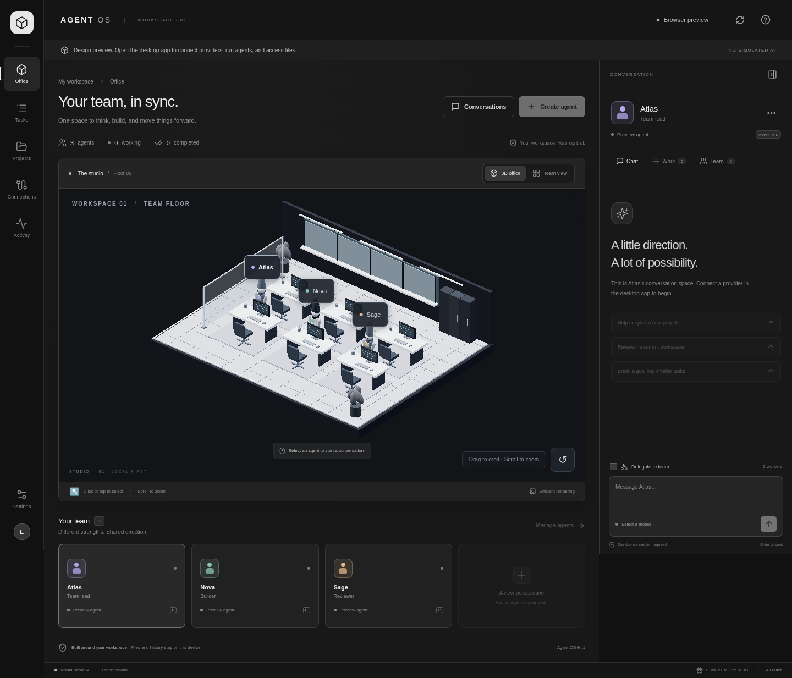

# Agent OS

A local-first Windows workspace for an AI team: an interactive 3D office, direct agent conversations, supervisor delegation, project-scoped work, and verified Git publication.

Built with Tauri 2, React, Three.js, Rust, and SQLite. The desktop application owns execution and credentials; the web interface cannot directly run shell commands or contact providers.



## Get the Windows app

The [Windows desktop workflow](https://github.com/hryvd/agent_os/actions/workflows/windows.yml) tests and packages an x64 NSIS installer on pushes to `main`. Open a **successful** workflow run and download the `agent-os-windows-x64` artifact, extract it, and run the setup executable. A failed or pending run is not an available installer. Prerelease installers are not code-signed.

The installer does not install or sign in to third-party AI products. Install the providers you want to use and connect them below. Microsoft WebView2 is required by the desktop shell.

## Start from source on Windows

Install Node.js 24, Git, Rust stable, Microsoft C++ Build Tools (Desktop development with C++ and a Windows SDK), and WebView2, following the [Tauri prerequisites](https://v2.tauri.app/start/prerequisites/).

In PowerShell, from this checkout:

```powershell
npm ci
cargo test --locked --manifest-path crates/agent-core/Cargo.toml
npm run tauri -- dev
```

Build an installer with:

```powershell
npm run tauri -- build --ci --bundles nsis -- --locked
```

The output is in `src-tauri/target/release/bundle/nsis/`.

## First project

1. Open **Connections** and add/test your chosen provider.
2. Open **Projects** and select an existing local directory. For Git publishing, configure its remote, branch, and a meaningful validation command.
3. Create an agent with that connection, model, project, and working instructions. Create additional agents and set their **Reports to** field to form a team.
4. Message an agent directly, or use team delegation for a supervisor's saved workers. Inspect task outputs and errors in **Tasks** and **Activity**.
5. Validate a project milestone, then publish it. Enable automatic post-validation publishing in that project's settings if desired.

Project commands run with your Windows user permissions. Only add projects and validation commands you trust. Local model tools are restricted to their selected workspace; installed third-party coding CLIs also retain their own permission and sandbox behavior. Review changes before treating them as a release.

## Connections

| Connection | Setup |
| --- | --- |
| Ollama | Install [Ollama](https://ollama.com), run a small supported model, and use the local endpoint. Enter the actual installed model name. A good first evaluation on an 8 GB PC is a small quantized 1–3B model, not multiple large models. |
| Codex | Install the [official Codex CLI](https://github.com/openai/codex) and sign in using its supported flow. It must be available on the app's inherited `PATH`. Restart Agent OS after changing `PATH`. |
| Claude Code | Install [Claude Code](https://github.com/anthropics/claude-code), sign in, and configure its supported permissions. The application does not bypass its approval system. |
| OpenAI-compatible | Supply the HTTPS API base URL, model, and API key if required. API eligibility and billing are separate from chat subscriptions. |
| OmniRoute | Connect a configured [OmniRoute](https://github.com/cheaper-inference/OmniRoute) gateway using its API base URL and key. Prefer a remote/existing instance for this hardware. |

API keys and Drive refresh tokens use the operating system credential store, not project files or the conversation database. Saving a key fails clearly if the credential store is unavailable; there is no plaintext fallback. CLI account sessions stay under the CLI's own control. Provider output is persisted as conversation/task history; avoid asking agents to disclose secrets.

**Ponytail:** the per-agent profile adds simplification and verification instructions. It does not falsely report that the upstream plugin is installed. For the full native plugin and its host-specific review/audit commands, follow the [official Ponytail installation](https://github.com/dietrichgebert/ponytail). Existing project instruction files are not overwritten.

**Google Antigravity:** direct external task control is not implemented. Official CLI documentation could not be verified because the cloud network policy blocks its documentation host. This is not a claim that the product lacks an API. The application does not scrape an IDE session or repurpose account cookies.

## Google Drive and offline files

Drive integration uses a Google OAuth **Desktop app** client with the Drive API enabled and the `drive.file` scope. Configure the client ID and, if required by that client, its client secret in the app. Use **Connect Drive**, complete consent in the browser, and return to the application. Refresh tokens are stored in the OS credential store.

Project backups are versioned ZIP snapshots uploaded through a resumable, bounded-memory transfer. Choose a local export directory or use the connected Drive backup action. An optional Drive folder must be accessible under the app's OAuth scope. Snapshots omit Git internals, build caches, credential/config files, and symlinks. Inspect what a project contains before uploading it.

Local files, history, and local models can work offline. Cloud inference, Drive uploads, and Git pushes need a connection. Drive is snapshot backup, not live two-way synchronization or a replacement for a local execution directory. Failed uploads and pushes remain visible; do not assume they completed.

## Verified publishing

Validation runs your configured command against a specific project candidate. A successful exit is required; choose commands that actually execute the checks the project needs. The app cannot infer that every arbitrary command ran meaningful tests.

Publishing checks that the candidate and approved destination still match, creates a checkpoint, pushes that exact commit without force, and confirms the remote revision. Editing files or changing the destination invalidates the prior receipt. Failed validation blocks publication. With **Automatically push after successful validation** enabled, pressing **Validate** also publishes that verified milestone; normal chat does not silently publish a project.

## Resource policy

Designed for a Ryzen 4500 / GTX 1650 / 8 GB RAM target, with two cloud run slots and one local run slot. Actual Windows memory/frame-rate measurements on that device are still required. Task count and model context are bounded; project edits are coordinated rather than allowing workers to overwrite a shared checkout concurrently.

Use efficient graphics or the equivalent 2D team view. The office pauses when hidden and scales render resolution. One local model can serve several saved agents sequentially. Models and CLI subprocesses consume memory in addition to the application.

OmniRoute's [coding-workload guide](https://github.com/cheaper-inference/OmniRoute/blob/main/docs/guides/DOCKER_GUIDE.md#runtime-ram-for-coding-agents) recommends memory configurations larger than this machine's entire RAM for long coding sessions. Running its complete coding gateway locally is not a supported hardware claim here. A remote gateway or direct provider connection avoids that extra local service. Virtual RAM does not replace VRAM or make large models fast.

## Development checks

```sh
npm ci
npm run build
cargo test --locked --manifest-path crates/agent-core/Cargo.toml
npx playwright install chromium
npm run test:ui
```

`npm run dev` opens the browser **design preview**, not a browser-hosted agent engine. It labels its sample office clearly and disables backend actions. Run `npm run tauri -- dev` on a machine with Tauri prerequisites for the real application.

UI tests cover preview behavior and a mocked native bridge contract. Core tests exercise persistence, provider HTTP behavior against a local test server, workspace tools, task state, OAuth validation, snapshots, and real Git repositories. Native CLI account behavior, real cloud-provider access, Google consent/uploads, Windows installation, and the target PC's performance require the corresponding credentials/platform and are not established by those tests.

The original product direction and build phases are in [PLAN.md](PLAN.md).
